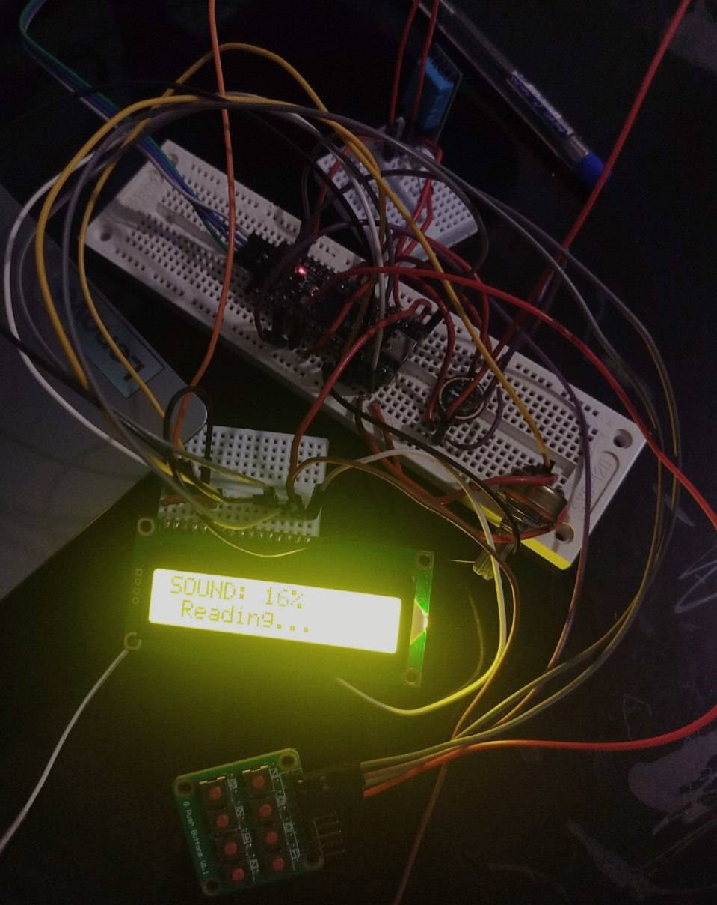
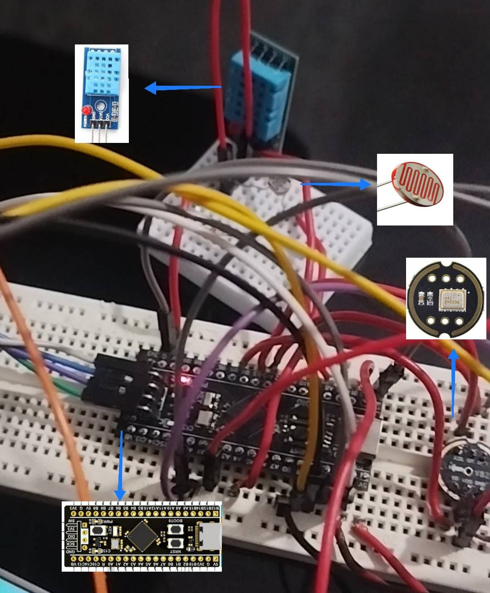
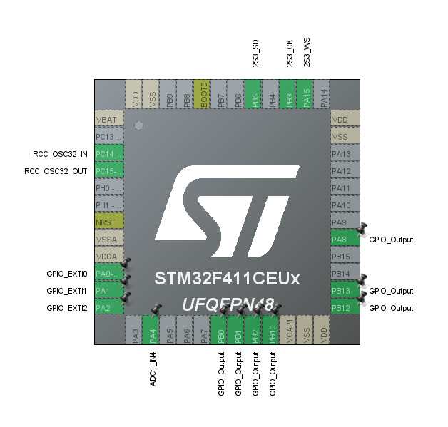
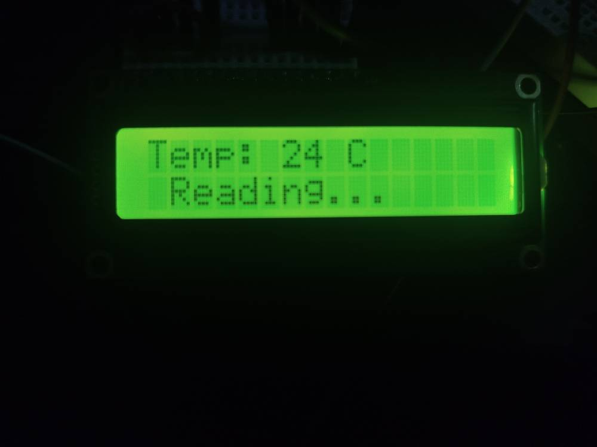
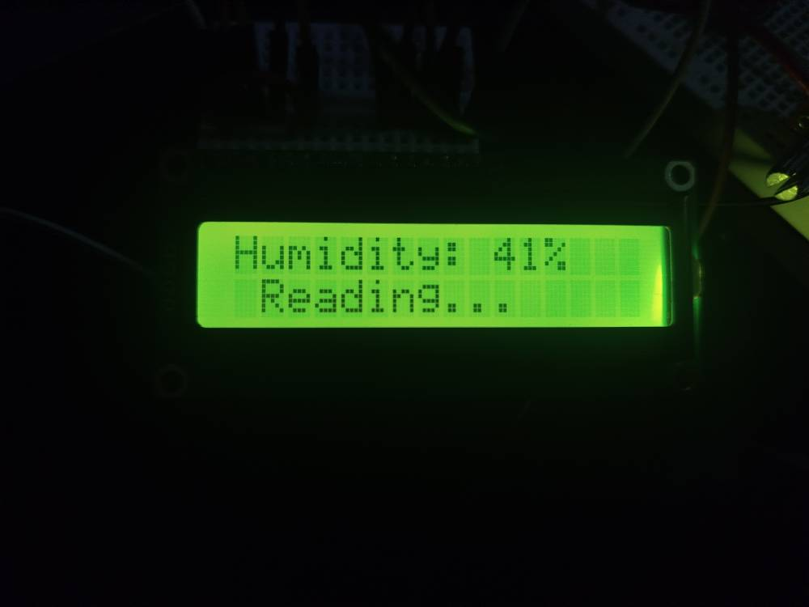
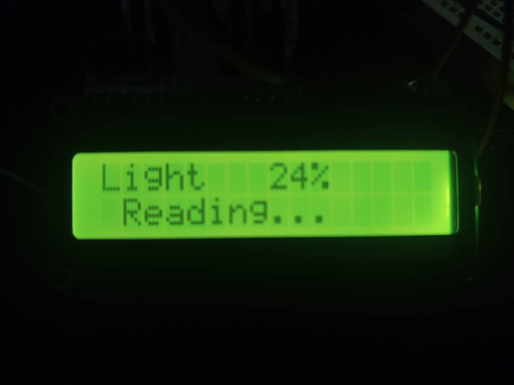
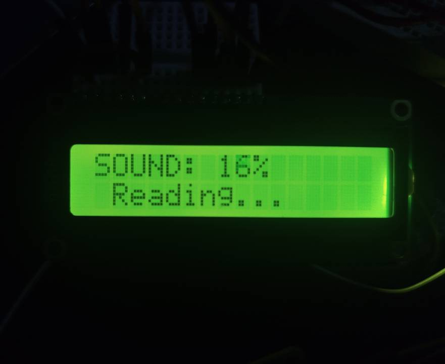
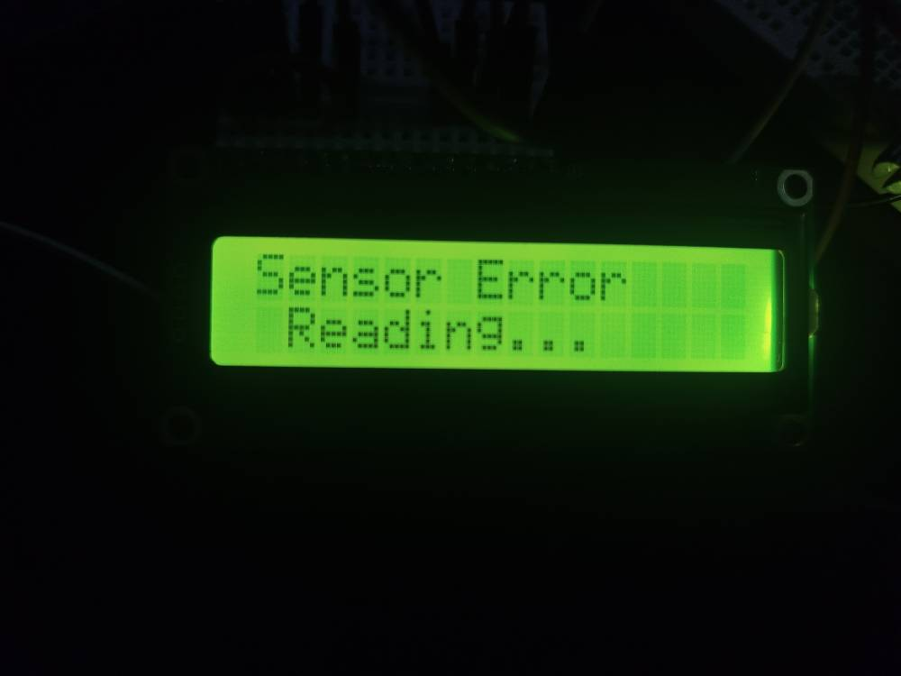
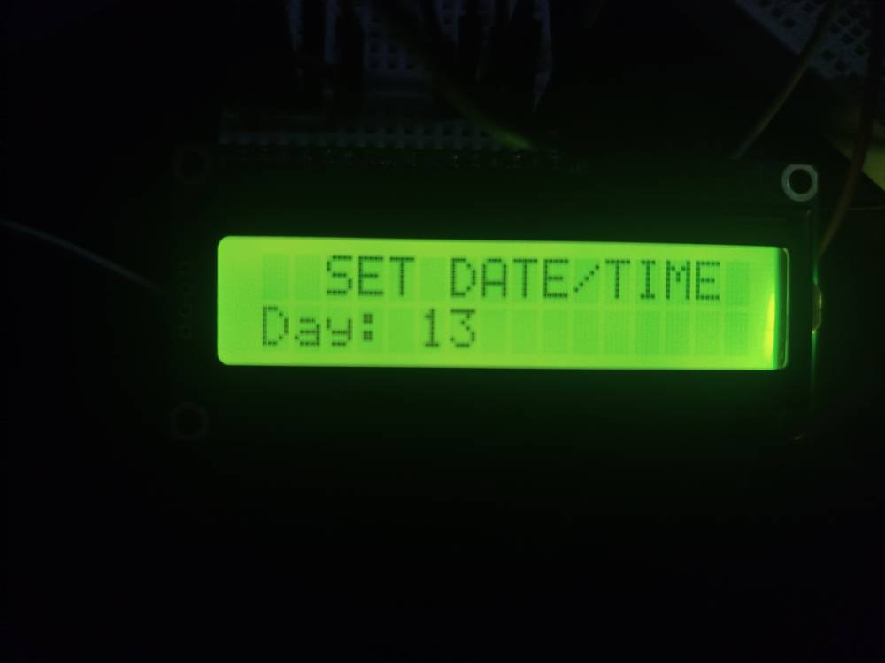

# STM32 Environmental Monitoring Dashboard

A multi-functional embedded monitoring system built around the STM32F411CEU6 (Black Pill). The project integrates environmental sensing, real-time clock functionality, audio data acquisition, and an interactive LCD interface.

The main goal is to practice and demonstrate practical STM32 peripheral programming and hardware-software integration in a single embedded project.

## Project Overview

The dashboard collects environmental data and displays it on a 16×2 character LCD. Users can navigate between different monitoring pages using physical buttons.

### Main images

## Main Features

- Temperature and Humidity: Reads environmental data using the DHT11 sensor through its single-wire timing-based communication protocol.
- Ambient Light Monitoring: Uses an LDR voltage divider and the STM32 ADC to measure relative light intensity.
- Real-Time Clock: Displays time and date using the STM32 internal RTC peripheral.
- Audio Data Acquisition: Interfaces with an INMP441 digital MEMS microphone using the I2S peripheral.
- DMA-Based Audio Reception: Uses DMA in circular mode to receive audio samples with minimal CPU intervention.
- LCD User Interface: Displays sensor readings, time, date, and sound-level information on a 16×2 LCD.
- Button-Based Navigation: Uses GPIO inputs and external interrupts to navigate between dashboard pages and interact with the interface.

## Hardware Components

Component| Purpose
STM32F411CEU6 Black Pill| Main microcontroller
DHT11| Temperature and humidity sensing
LDR + resistor| Ambient light sensing
INMP441| Digital MEMS microphone
16×2 LCD (HD44780)| User interface
Push buttons| Menu navigation and interaction

## STM32 Peripherals and Concepts

This project demonstrates the use of several STM32 peripherals and embedded programming concepts:

- GPIO input/output configuration
- External Interrupts (EXTI)
- Analog-to-Digital Conversion (ADC)
- Inter-IC Sound (I2S)
- Direct Memory Access (DMA)
- Real-Time Clock (RTC)
- Microsecond timing using the Cortex-M4 DWT cycle counter
- Sensor communication and data processing
- Modular C programming using separate header and source files

## System Architecture

             Sensors
                |
      +---------+----------+
      |         |          |
    DHT11      LDR       INMP441
      |         |          |
      |        ADC         I2S
      |         |          |
      +---------+----------+
                |
           STM32F411
                |
      +---------+----------+
      |                    |
     RTC               DMA / Audio
      |                    |
      +---------+----------+
                |
          Dashboard Logic
                |
          16x2 LCD Display
                |
        Button-Based Control

## Hardware Connections

LCD (HD44780, 4-bit mode)

LCD Pin| STM32 Pin
RS| PB0
EN| PB1
D4| PB2
D5| PB10
D6| PB12
D7| PB13
RW| GND

Sensors and Inputs

Module| STM32 Pin / Interface
DHT11 DATA| PA8
LDR analog output| PA4 (ADC1_IN4)
INMP441 SCK| PB3 (I2S3_CK)
INMP441 WS| PA15 (I2S3_WS)
INMP441 SD| PB5 (I2S3_SD)
NEXT button| PA0
PREV button| PA1
SET button| PA2

Note: Connect all modules to a common GND. Check the voltage requirements of each module before wiring it to the microcontroller.

## Software Structure

The firmware is organized into separate modules to keep hardware drivers and dashboard logic independent.

- "dht11.c / dht11.h" — DHT11 communication and data reading.
- "sound.c / sound.h" — I2S audio reception and sound-level processing.
- "lcd.c / lcd.h" — LCD driver and display functions.
- "dashboard.c / dashboard.h" — Dashboard pages, navigation, and data presentation.
- "main.c" — Application initialization and main execution flow.

The file list above describes the logical modules; adjust the names if your actual project structure differs.

## Key Implementation Highlights

1. DHT11 Timing-Based Communication

The DHT11 does not use a standard communication interface such as I2C or SPI. Its data is transferred through precisely timed digital pulses.

The driver uses the STM32 GPIO in open-drain mode and the Cortex-M4 DWT cycle counter for microsecond-level timing.

2. I2S and DMA Audio Acquisition

The INMP441 microphone provides digital audio data through I2S.

The STM32 receives audio samples using DMA in circular mode. This allows data acquisition to continue with less CPU involvement compared with continuously polling the peripheral.

3. ADC-Based Light Measurement

The LDR and a fixed resistor form a voltage divider. The voltage at the divider output is sampled using the STM32 ADC.

The measured value represents relative ambient light intensity rather than a calibrated lux measurement.

4. Modular Firmware Design

The project separates peripheral drivers from application-level dashboard logic. This makes the firmware easier to understand, maintain, test, and extend.

## LCD images

## Project Status

This project is a trial embedded-systems project focused on STM32 peripheral configuration, sensor interfacing, firmware architecture and modular coding.

## Author

Abolfazl Afroogh 

